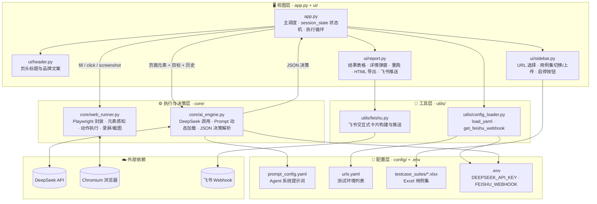
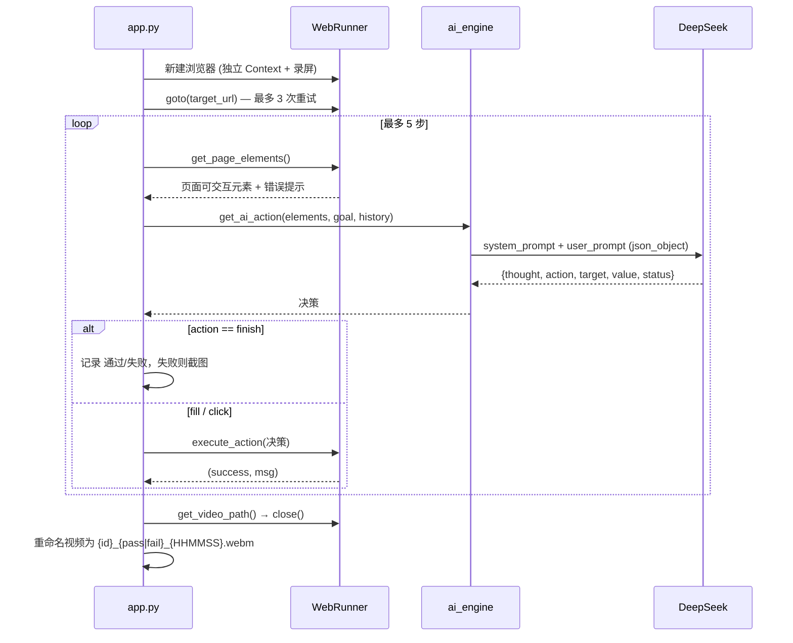

<div align="center">

# 🤖 AI 驱动的智能 Web 自动化测试平台

**AI Web Test Platform — 让大模型做决策，让 Playwright 做执行**

[](https://www.python.org/)
[](https://streamlit.io/)
[](https://playwright.dev/python/)
[](https://platform.deepseek.com/)
[](https://open.feishu.cn/)
[](#-license)

</div>

---

## 📖 项目简介

本项目是一个以 **Streamlit** 为交互入口、**Playwright** 为执行引擎、**DeepSeek 大模型** 为决策大脑的智能 Web 自动化测试平台：测试人员只需在 Excel 中用自然语言描述测试目标，平台即可自主感知页面、规划操作、判定结果，并产出含录屏、截图、AI 思考日志的全链路审计报告，实现从「写脚本」到「写意图」的测试范式升级。

---

## ✨ 核心亮点

### 1️⃣ AI 驱动执行：告别死板硬编码

传统 UI 自动化的核心痛点是「脚本与页面强耦合」——一个 `id` 变更就能让上百条用例集体报废。本平台采用 **感知 → 决策 → 执行 → 反馈** 的 Agent 闭环：

| 阶段 | 职责 | 实现 |
|:---:|:---|:---|
| 👁️ 感知 | `WebRunner.get_page_elements()` 通过 `page.evaluate` 抓取页面所有 `input / button / a` 的 `tag / type / placeholder / text / id` 及错误提示文本 | Playwright |
| 🧠 决策 | `get_ai_action()` 将「测试目标 + 历史动作 + 当前页面元素」喂给 DeepSeek，强制返回结构化 JSON（`thought / action / target / value / status`） | DeepSeek `json_object` 模式，`temperature=0.1` |
| ⚙️ 执行 | `WebRunner.execute_action()` 将 AI 决策翻译为 `fill / click` 等真实浏览器操作 | Playwright 语义化定位器 |
| 🔁 反馈 | 每一步的动作写入 `history`，作为下一轮决策的上下文，最多 5 步自动收敛 | 应用层循环控制 |

用例不再是代码，而是一句话：

> `用例编号: TC_LOGIN_001 | AI执行指令: 使用 standard_user / secret_sauce 登录，验证进入商品页`

Prompt 与代码完全解耦，存放于 `config/prompt_config.yaml`，**每次调用动态热加载**，调整判定规则无需重启服务。

### 2️⃣ 全量审计与闭环：证据链零丢失

- **每条用例独立录屏**：`WebRunner` 为每条用例新建独立 `BrowserContext`，以 1280×720 录制 `.webm` 视频。
- **按时间戳隔离存放**：每次点击「执行」生成专属目录 `videos/20261108_185910/`，文件名形如 `TC_LOGIN_002_pass_185944.webm`，**同名用例重跑绝不覆盖历史证据**。
- **失败现场留档**：失败即截图至 `screenshots/{case_id}_fail.png`，与 AI 思考日志一同在详情弹窗中展示。
- **失败用例一键重跑**：报告页自动筛选失败集合，重跑结果按 `case_id` **原位替换**对应记录，而非追加，报告始终保持与用例集一一对应。

### 3️⃣ 企业级用例管理：Excel 即用例集

- 用例集以 `.xlsx` 形式存放于 `config/testcase_suites/`，侧边栏自动扫描并支持 **多套测试集切换**（如「冒烟 3 条」/「全量十几条」）。
- 支持通过 UI **直接上传**新的 Excel 用例集，自动落盘并立即可用。
- 列名**模糊匹配**（`用例编号 / 测试标题 / 优先级 / AI执行指令`），自动 `strip` 空白符，容忍业务同学在 Excel 中的书写差异。
- 空指令行自动过滤，避免无效调用浪费 Token。

### 4️⃣ 优雅中断机制：长任务随时可控

Streamlit 的脚本式重跑模型天然不适合长任务控制。本平台基于 `st.session_state` 设计了一套轻量级的**状态机**：

```
is_running / stop_requested / has_run / retry_list / results_data / video_dir
```

- 点击「🛑 停止执行」仅置位 `stop_requested` 并触发 `st.rerun()`，不粗暴杀进程。
- 执行循环在**每条用例边界**检查停止标志，确保当前用例的浏览器资源在 `finally` 中正常释放、视频正常落盘，再优雅退出。
- 侧边栏按钮随状态互斥切换（运行中隐藏「执行」，仅显示「停止」），杜绝误操作导致的并发执行。

### 5️⃣ DevOps 集成：报告与通知自动化

- **HTML 报告一键导出**：基于 `pandas` 生成带样式的独立 HTML 报告（通过/失败红绿高亮），可直接归档或挂接到 CI 产物。
- **飞书 Webhook 实时推送**：`utils/feishu.py` 组装飞书 **交互式卡片**，根据结果动态切换卡片主题色（全通过 🎉 绿 / 有失败 🚨 红），一屏呈现测试环境、执行时间、通过率、成功/失败数。
- Webhook 地址由 `utils/config_loader.get_feishu_webhook()` 从 `.env` 统一读取，未配置时 UI 给出明确引导，不阻塞主流程。

---

## 🏗️ 架构设计

平台采用经典的**分层解耦架构**：视图层不关心浏览器如何操作，执行层不关心大模型如何决策，决策层不关心结果如何展示，配置与密钥读取统一收口到工具层。



### 单条用例执行时序



### 分层职责说明

| 层级 | 目录 | 职责 | 对外依赖 |
|:---|:---|:---|:---|
| **视图层** | `app.py`, `ui/` | `app.py` 负责流程编排与 `session_state` 状态管理；`ui/header.py`、`ui/sidebar.py`、`ui/report.py` 分别承载页头、侧边栏、报告页三块独立 UI 组件 | 仅依赖 `core` 与 `utils` 的公开接口 |
| **决策层** | `core/ai_engine.py` | 组装 Prompt、调用大模型、解析并兜底 JSON 决策 | DeepSeek API, `config/prompt_config.yaml` |
| **执行层** | `core/web_runner.py` | 浏览器生命周期管理、元素感知、动作执行、录屏与截图 | Playwright |
| **工具层** | `utils/` | `config_loader.py` 统一封装 YAML 读取与环境变量获取；`feishu.py` 负责通知推送 | 飞书 Webhook, `.env` |
| **配置层** | `config/`, `.env` | Prompt、环境地址、Excel 用例集、密钥，**零代码可调** | — |

> 💡 **可扩展性**：替换大模型只需改 `ai_engine.py` 中的 `client`；新增动作类型（如 `select`、`hover`）只需在 `execute_action` 中增加分支并同步更新 `prompt_config.yaml`；新增配置项只需在 `config_loader.py` 中追加一个 getter；视图层无需任何改动。

---

## 🛠️ 快速启动指南

### 环境要求

- macOS（已在 Apple Silicon / Intel 上验证），Linux 同理
- Python 3.10+
- 可访问 DeepSeek API 的网络环境

### Step 1 · 克隆项目并创建隔离虚拟环境

强烈建议使用 `venv` 隔离，避免 Playwright 浏览器依赖污染全局 Python 环境。

```bash
git clone <your-repo-url> AI_Web_Test
cd AI_Web_Test

python3 -m venv venv
source venv/bin/activate         # 激活后终端提示符前会出现 (venv)
python -m pip install --upgrade pip
```

### Step 2 · 安装依赖

```bash
pip install streamlit playwright openai pandas openpyxl pyyaml python-dotenv requests

# 安装 Playwright 的 Chromium 内核（首次约下载 150MB）
playwright install chromium
```

> 建议将上述依赖固化为 `requirements.txt`：`pip freeze > requirements.txt`，便于团队复现。

### Step 3 · 配置 `.env`（脱敏配置，切勿提交到 Git）

在项目根目录创建 `.env` 文件：

```dotenv
# DeepSeek 大模型 API Key —— https://platform.deepseek.com/
DEEPSEEK_API_KEY=sk-xxxxxxxxxxxxxxxxxxxxxxxx

# 飞书群机器人 Webhook —— 群设置 → 群机器人 → 添加「自定义机器人」
FEISHU_WEBHOOK=https://open.feishu.cn/open-apis/bot/v2/hook/xxxxxxxx-xxxx-xxxx-xxxx-xxxxxxxxxxxx
```

`.env` 与 `videos/` 已加入 `.gitignore`。所有密钥通过 `python-dotenv` 在运行时注入，并由 `utils/config_loader.py` 统一对外提供读取接口，业务代码中**不出现任何明文凭证，也不直接散落 `os.getenv` 调用**。

### Step 4 · 配置测试环境与用例集

- 编辑 `config/urls.yaml`，添加你的被测环境地址。
- 在 `config/testcase_suites/` 下放置 Excel 用例集，表头至少包含以下四列：

| 用例编号 | 测试标题 | 优先级 | AI执行指令 |
|:---|:---|:---|:---|
| TC_LOGIN_001 | 标准用户正常登录 | P0 | 使用用户名 standard_user、密码 secret_sauce 登录，验证成功进入商品列表页 |
| TC_LOGIN_002 | 错误密码登录被拒 | P1 | 使用用户名 standard_user、密码 wrong_pwd 登录，预期页面出现错误提示（异常场景） |
| TC_LOGIN_003 | 锁定用户登录被拒 | P1 | 使用 locked_out_user / secret_sauce 登录，预期出现账号被锁定提示（异常场景） |

### Step 5 · 启动平台

```bash
streamlit run app.py
```

浏览器自动打开 `http://localhost:8501`，在左侧边栏选择目标 URL 与用例集，点击 **🚀 执行所有测试用例** 即可。

---

## 📂 项目目录树

```
AI_Web_Test/
├── app.py                          # 🚪 入口：Streamlit 主程序，状态机 + 执行循环编排
├── .env                            # 🔐 密钥配置（已 gitignore，勿提交）
├── .gitignore
├── README.md
│
├── core/                           # ⚙️ 执行与决策层
│   ├── __init__.py
│   ├── ai_engine.py                #    🧠 DeepSeek 调用、Prompt 热加载、JSON 决策解析与兜底
│   └── web_runner.py               #    🎭 Playwright 封装：感知 / 执行 / 录屏 / 截图 / 生命周期
│
├── ui/                             # 🖥️ 视图组件层
│   ├── __init__.py
│   ├── header.py                   #    页头：平台标题与文案
│   ├── sidebar.py                  #    侧边栏：URL 选择、用例集切换与上传、启停按钮
│   └── report.py                   #    报告页：结果表格、详情弹窗、失败重跑、HTML 导出、飞书推送
│
├── utils/                          # 🧰 工具层
│   ├── __init__.py
│   ├── config_loader.py            #    load_yaml（读取 config/*.yaml）、get_feishu_webhook（读取 .env）
│   └── feishu.py                   #    飞书交互式卡片构建与 Webhook 推送
│
├── config/                         # 📄 配置层（零代码可调）
│   ├── prompt_config.yaml          #    Agent 系统提示词：JSON 协议、判定规则、定位规则
│   ├── urls.yaml                   #    被测环境地址列表
│   └── testcase_suites/            #    Excel 用例集（支持多套切换 + UI 上传）
│       ├── 登录用例3条.xlsx
│       └── 登录用例十几条.xlsx
│
├── screenshots/                    # 📸 失败现场截图：{case_id}_fail.png
│   └── TC_LOGIN_003_fail.png
│
├── videos/                         # 🎥 执行录屏（已 gitignore），按执行批次时间戳隔离
│   ├── 20261108_185117/
│   │   ├── TC_LOGIN_001_pass_185132.webm
│   │   └── ...
│   └── 20261108_185910/
│       ├── TC_LOGIN_001_pass_185923.webm
│       └── TC_LOGIN_002_pass_185944.webm
│
└── venv/                           # 🐍 Python 虚拟环境（建议加入 .gitignore）
```

---

## 💡 踩坑与思考

### 坑一：AI「以为」填进去了，实际上输入框是空的

**现象**：大模型返回了正确的 `fill` 决策，Playwright 的 `fill()` 也没有抛异常，但点击登录后却提示「用户名不能为空」。回看录屏发现输入框确实是空的——这是一种典型的「执行侧幻觉」：AI 和框架都认为动作成功，但受控组件（React/Vue）并未真正更新内部 state。

**根因**：`fill()` 通过直接设置 DOM `value` 并派发 `input` 事件来模拟输入，部分受控组件或带复杂监听的输入框并不响应这种合成事件。

**解决方案**：在 `WebRunner.execute_action` 中引入 **「填充 → 自检 → 键盘兜底」** 三段式策略：

```python
target_input.click()
target_input.fill("")                       # 强制清空，避免残留
target_input.fill(value)
self.page.wait_for_timeout(500)             # 给前端框架反应时间
if target_input.input_value() != value:     # 自检：读回真实值比对
    target_input.press_sequentially(value, delay=50)   # 逐字符键盘输入兜底
```

`press_sequentially` 会逐个字符触发真实的 `keydown / keypress / input / keyup` 事件链，任何前端框架都无法「忽略」。**不信任动作返回值，只信任页面真实状态**，这是 AI 自动化中必须坚持的防御性原则。

### 坑二：React 页面「加载完成」只是假象，元素抓不到

**现象**：`page.goto()` 返回后立即调用 `get_page_elements()`，AI 拿到的是一份残缺的元素列表（甚至为空），于是它做出错误决策，或直接判定「找不到登录按钮，测试失败」。

**根因**：SPA 页面的 `load` / `domcontentloaded` 事件只代表 HTML 骨架与 JS Bundle 加载完毕，真正的 UI 由 JS 在之后异步渲染；网络抖动时 `goto` 甚至直接超时。

**解决方案**：

1. **导航层加重试**：`goto()` 使用 `wait_until="domcontentloaded"` + 15s 超时，失败自动重试 3 次并间隔 2s，抵御测试环境网络抖动。
2. **动作层加缓冲**：每个动作执行后固定 `wait_for_timeout(1000)`，确保页面完成状态变更后再进入下一轮感知。
3. **决策层加约束**：在 Prompt 中明确规定「点击后必须在下一步重新观察页面再判定」，避免 AI 在页面未渲染完毕时过早输出 `finish`。

> 进阶方向：用 `page.wait_for_selector` / `wait_for_load_state("networkidle")` 替代固定等待，并在元素抓取为空时自动延迟重采样。

### 坑三：AI 决策不稳定——该停不停、该填不填、用 id 而非文案定位

**现象**：早期 Prompt 下，AI 会出现：① 输入错误密码后看到报错，却判定为「失败」（其实这是异常场景的预期结果）；② 没填完所有必填项就急着点登录；③ 返回 `login-button` 这类源码 `id`，而页面上根本没有这个可见文本。

**解决方案**：把 Prompt 当成**测试规范文档**来写，而非聊天指令，并落地为 `config/prompt_config.yaml` 中的四组硬规则：

| 规则组 | 内容 | 解决的问题 |
|:---|:---|:---|
| 判定结束规则 | 点击后必须下一步再观察；出现 `inventory / Products` 判通过，出现 `Epic sadface / Error` 判失败 | 过早 finish |
| 核心判定规则 | **异常场景出现预期报错 = passed**；正常场景出现报错 = failed | 语义反转 |
| 元素定位规则 | 输入框优先 `placeholder`，按钮优先可见文字，禁止返回 `id` | 定位失效 |
| 执行原则 | 点提交前检查历史，确保所有必填项已 fill，且不重复 fill | 漏填 / 重复填 |

配合 `temperature=0.1` 与 `response_format={"type": "json_object"}`，将大模型的随机性压到最低，让「确定性」重新回到测试工程师手中。同时 `ai_engine.py` 对任何 API 异常做兜底，统一返回 `{"action": "finish", "status": "failed"}`，保证单条用例的失败不会拖垮整个批次。

---

## 🗺️ Roadmap

- [ ] 动作集扩展：`select` / `hover` / `press` / `upload`，覆盖更多表单场景
- [ ] 智能等待：以 `networkidle` 与元素可见性判断替代固定 `sleep`
- [ ] 多模态感知：接入截图 + 视觉模型，突破 DOM 元素抓取的局限
- [ ] 并行执行：多 Context 并发跑用例，缩短大用例集执行时长
- [ ] 历史趋势：结果持久化至 SQLite，报告页展示通过率趋势图
- [ ] CI 接入：提供 headless CLI 模式，便于挂接 Jenkins / GitHub Actions 定时巡检

---

## 📄 License

MIT © 2026
